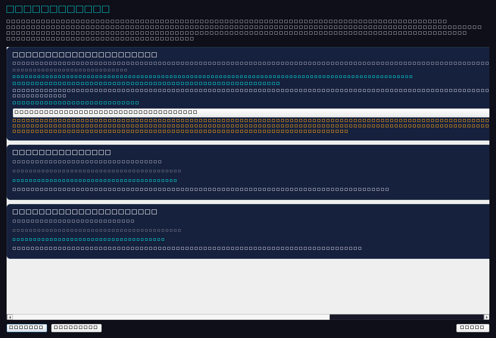
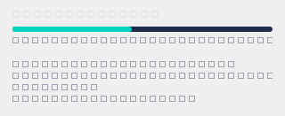

# DRAGGY ENCODER

**Cross-platform video compression app with AI-powered workflow pipeline.**

DRAGGY ENCODER combines FFmpeg-based encoding with ONNX/PyTorch AI models for video upscaling, frame interpolation (RIFE/FILM), colorization, and denoising — all in a visual drag-and-drop workflow.

## Features

- GPU-accelerated AI upscaling (Real-ESRGAN, OmniSR, CUGAN, SwinIR) via ONNX Runtime (CUDA/TensorRT)
- Frame interpolation (RIFE, FILM) via PyTorch/ONNX
- Frame-by-frame decode → AI → encode pipeline with audio passthrough
- Auto-downloading FFmpeg (latest BtbN gpl build) and AI models from HuggingFace
- NVENC / AMF / QuickSync GPU encoder support
- Two-pass EBU R128 loudness normalization (audio boost)
- Side-by-side preview comparison with zoom + pan
- Persistent render queue: queue several videos and cancel any single job
- Pick which audio track to keep, or keep all of them
- Live GPU / CPU / VRAM meters while a render runs
- AI engines rated by speed and quality **measured on your own machine**
- Multi-language UI (English / Spanish)
- Auto-update chain for dependencies
- PyInstaller-ready for portable Windows/Linux distribution

## Quick Start

```bash
git clone https://github.com/thedevil4k/Draggy-Encoder.git
cd Draggy-Encoder

python -m venv venv
venv/Scripts/activate   # Windows
# source venv/bin/activate   # Linux
pip install -r requirements.txt
python main.py
```

On first launch the app auto-detects your hardware, downloads FFmpeg + ONNX Runtime + PyTorch if needed, and tests all compatible GPU/CPU codecs — no configuration required.

### Choosing the FFmpeg version

The FFmpeg row of **Manage Dependencies** has a version selector. By default
nothing changes: the program keeps installing the same rolling build it always
did. But you can pick another published build — useful when a newer FFmpeg is
compiled against a newer NVIDIA Video Codec SDK and asks for a driver your GPU
no longer gets.

- **Windows** — master, 9.0 and 8.1 are rebuilt daily by BtbN and all three
  need driver 570+; 7.1, 6.1 and 5.1.6 are BtbN's frozen October 2024 snapshot
  (551.76 / 522.25 / 471.41) and are the ones that still work on an older
  laptop GPU.
- **Linux** — the same rolling builds, plus the frozen 6.0 / 5.1 / 4.4 static
  builds (down to driver 455).

Each option is colour-coded against the hardware detected on your machine. The
codecs attributed to an NVIDIA GPU are not guessed from the architecture: they
are transcribed from NVIDIA's published Video Encode and Decode Support Matrix,
so a model that NVIDIA lists with zero NVENC engines (some MX, the GT 1030, the
Quadro P500/P520) is never painted green.

- **Green** — the GPU is a known NVENC model *and* your driver is at or above
  the minimum that FFmpeg branch requires (the same number the binary itself
  prints when it cannot open NVENC).
- **Amber** — it cannot be checked: unknown GPU model, driver version not
  readable, a GPU NVIDIA publishes with no NVENC engines (encoding goes through
  the CPU, so the build does not decide anything), or an AMD/Intel encoder whose
  availability does not depend on the FFmpeg version. Install it and
  *Re-detect Hardware & Codecs* to measure the real thing.
- **Red** — your driver is below that build's minimum; the note also lists the
  builds that do work with your driver, and says so plainly when no published
  build covers it.
- **Grey** — the machine has no dedicated GPU, so every build encodes on the CPU
  alike and the version is irrelevant here.

The note under the selector also says *why* a build needs the driver it needs,
so a rebuilt branch whose minimum is the same as master's does not look like a
solution to an old driver when it is not.

## Project Structure

```
DRAGGY_ENCODER/
├── main.py                  # Entry point
├── requirements.txt          # Python dependencies
├── requirements-build.txt    # Extra pins used only when freezing a bundle
├── LICENSE                   # MIT
├── perf-audit.md             # Notes from the performance audit
├── assets/                   # UI icons (the packaged app bundles this whole folder)
├── screenshots/              # Images used by this README
├── tests/                    # pytest suite (`python -m pytest tests -q`)
│   └── data/                 # Reference data as plain modules (no binaries)
├── packaging/linux/          # AppImage + Flatpak metadata and build helpers
├── .github/workflows/        # Installer and AppImage builds, release artifacts
├── draggy_encoder.spec       # PyInstaller spec (bundles all of assets/)
├── draggy_encoder.iss        # Inno Setup script for the Windows installer
├── bin/                      # Downloaded binaries (auto-generated, gitignored)
│   ├── .session/             # Preferences, queue & render history, engine state
│   ├── ffmpeg/               # FFmpeg (auto-downloaded on first run)
│   ├── runtimes/             # PyTorch + ONNX Runtime (pip install --target)
│   ├── models/               # Downloaded AI model weights
│   └── logs/                 # Render logs & FFmpeg logs
├── personal/                 # HuggingFace tokens (gitignored)
└── src/
    ├── ai/                   # AI engine catalog, inference, architectures, HF search
    ├── ffmpeg/               # FFmpeg manager, downloader, runner, codec testing
    │   ├── builds.py         # catálogo de builds: cuáles hay, de dónde, cuál eligió el usuario
    │   ├── build_fit.py      # veredicto: ¿le sirve esa build a este equipo?
    ├── hardware/             # CPU/GPU detection + codec compatibility maps
    ├── dependencies.py       # registro de dependencias: sensores -> filas, REGISTRY, API
    ├── fsops.py              # el disco: medir un árbol y borrarlo aunque Windows no deje
    ├── processing/           # Video pipeline (AI frame-by-frame + standard encode)
    ├── runtimes/             # PyTorch/ONNX Runtime local install manager
    ├── ui/                   # PySide6 GUI components (~30 widgets)
    │   ├── dep_row.py        # la fila de una dependencia: qué se pinta y qué se puede hacer
    │   ├── ffmpeg_row.py     # monta el selector de versión dentro de la fila de FFmpeg
    │   ├── ffmpeg_build_picker.py  # el desplegable de builds, con su veredicto de GPU
    └── utils/                # Time/format helpers
```

### El panel de dependencias: quién manda en qué

Cuatro capas, y la dirección de la flecha es la regla para no volver a
enredarlas:

```
src/ui/dependencies_dialog.py   el panel, los hilos, la pestaña de motores
        │ importa
        ▼
src/ui/dep_row.py               qué dice la fila y qué botón está vivo
        │ importa
        ▼
src/dependencies.py             sensores -> filas, REGISTRY, y qué campos
                                son canónicos en una fila
        │ importa
        ▼
src/fsops.py                    el disco: medir y borrar aunque no se pueda
        ▲
        │ importan
src/ffmpeg/manager.py  ·  src/runtimes/manager.py
```

Dos reglas que costaron un disgusto y conviene no volver a romper:

- **Un sensor no se copia entero a una fila.** `runtimes.manager` devuelve
  claves de sensor (`installed`, `system`, `gpu`), no campos de fila; por eso
  `_runtime_status` nombra sus 13 campos uno a uno. En cambio
  `ffmpeg.manager.get_install_info()` ya *es* una fila, y por eso esa se
  copia entera. Está escrito en el sitio, en los dos.
- **La política de FFmpeg tiene un dueño:** `builds.nothing_to_offer_reason`.
  El manager la publica en la fila como `nothing_to_install` para el botón y
  el tooltip; el diálogo la vuelve a preguntar en el clic, a propósito,
  porque una confirmación tiene que hablar del mundo en el momento en que el
  usuario confirma y no de una foto de hace un segundo.
- **Lo que dice una fila lo deciden seis funciones puras, todas en
  `src/ui/dep_row.py`**, y por eso se prueban sin montar un widget:
  - `badge_text` — la palabra de la insignia.
  - `primary_label` — el texto del botón principal.
  - `primary_enabled` — si ese botón está vivo, y por qué no.
  - `ai_runtime_support_info` — si el runtime de IA tiene ruedas para este Python.
  - `humanize_age` — el «hace cuánto» del último check.
  - `format_latest_line` — la línea `Latest: … · last check: …`.

  `humanize_age` la usa también el banner de la ventana principal, así que los
  dos dicen lo mismo para el mismo instante. Y leer la marca de tiempo no lo
  decide ninguna de las dos: sale de `src/ffmpeg/builds.py`, que es el módulo
  que ya importan las tres capas que la necesitan. Ahí hay dos reglas con un
  dueño cada una —`parse_timestamp` es el único parseo de ISO y el único que
  sabe qué es una `Z` final; `ensure_utc` es el único que decide que una fecha
  sin zona se lee como UTC, y `upstream` lo llama en sus dos puntos de entrada
  en vez de repetirla—. Y lo que **no** se comparte, para que no se cuente como
  si sí: el parseo de las cabeceras RFC 1123 del upstream, que es otro formato
  y lo lee `upstream` con `parsedate_to_datetime`. Comparten qué significa
  "sin zona", no la lectura.


## Requirements

- Python 3.10–3.14
- GPU recommended for AI upscaling (NVIDIA CUDA or AMD Vulkan)
- No Git required: model downloads use the bundled `huggingface_hub`
  (the packaged app no longer falls back to `git clone`, since the
  Windows installer does not ship Git).

See `requirements.txt` for the full Python dependency list.

### AI runtimes: PyTorch vs ONNX Runtime

- **Converting a `.pth`/`.pt`/`.safetensors` checkpoint to `.onnx` requires
  PyTorch** — the app uses `torch.onnx.export` to rebuild the model from the
  checkpoint and export it.
- **Running an existing `.onnx` model only needs ONNX Runtime.** Models that
  already ship as `.onnx` (many HuggingFace repos do) don't require PyTorch
  at all.

On the first launch the app automatically downloads FFmpeg, ONNX Runtime,
and PyTorch — no manual setup required. ONNX models work immediately;
PyTorch is ready for `.pth` import/conversion without extra steps.
A failed runtime download never blocks the app from starting:
retry from *Manage Dependencies → AI Runtimes → Install*.

**The PyTorch build is resolved, not hardcoded.** Before downloading, the app
queries the PyTorch wheel indices and PyPI metadata and picks the
(variant, version) pair that actually publishes wheels for your CPython, your
platform and your NVIDIA driver — for example CUDA 13.0 builds on a recent
driver, or an older CUDA/CPU build otherwise. The progress dialog shows the
resolved choice (`CUDA 13.0 · torch 2.14.0 + torchvision 0.29.0 + …`).
If a download is interrupted or fails validation, the previously working
runtime is kept: the new files are assembled and verified in a temporary
directory and only then swapped in.

**Installing and uninstalling each runtime is independent.** PyTorch and ONNX
Runtime share one folder, but the Uninstall button on each row removes only
that runtime (plus its own satellites) and leaves the other one — and the
shared dependencies such as numpy — untouched. Read the confirmation dialog:
it tells you exactly what will be removed. On Windows, if the runtime is
loaded in memory its DLLs cannot be deleted immediately; the app schedules the
removal for the next launch and tells you so. Reinstalling before that restart
is safe: the pending cleanup recognises the new installation and leaves it
alone.

- Installing **ONNX Runtime** also installs `onnx`/`onnxscript`, which is what
  `torch.onnx.export` needs to convert `.pth` checkpoints.
- Installing **PyTorch** installs them too, so a `.pth`-only workflow works
  after installing either one.

### Audio Boost: two levels

- **Quick:** just the *Audio Boost (normalize volume)* checkbox. It applies the
  usual two-pass EBU R128 normalization (`loudnorm` `I=-16` / `TP=-1.5` /
  `LRA=11`) and raises the volume to the streaming standard with nothing to
  configure.
- **Detailed:** the *Avanzado* tab next to the checkbox opens an equalizer
  (bass/mid/treble), a dynamic-range compressor (threshold, ratio, attack,
  release, with presets) and a peak limiter.

The options in the dropdown **alter the boost itself**, they are not stacked on
top of it: the normalization is recalculated to let the equalizer and the
compressor do their job. With nothing enabled the boost behaves exactly as it
does with the dropdown closed, so merely opening it never changes the sound.

*Escuchar efecto* plays a short excerpt of the track with the current settings
applied; while it is playing, moving any control returns updated audio so you
can tune by ear, and *Parar* stops it.

## Portable builds

GitHub Actions publishes one package per platform:

- **Windows (x64):** `DraggyEncoder-Setup-*.exe`, built with PyInstaller and Inno Setup.
- **Linux (x86_64):** `DraggyEncoder-Linux-x86_64-*.AppImage`, directly executable.

The AppImage can be marked executable and launched from the file manager.

### Downloads — latest build

After every push to `main`, the rolling **Latest build** release is updated, so
these links always point to the newest build without waiting for a version tag:

- **Windows installer** (Inno Setup):
  [DraggyEncoder-Setup-1.exe](https://github.com/thedevil4k/Draggy-Encoder/releases/latest/download/DraggyEncoder-Setup-1.exe)
- **Linux AppImage**:
  [DraggyEncoder-Linux-x86_64-1.AppImage](https://github.com/thedevil4k/Draggy-Encoder/releases/latest/download/DraggyEncoder-Linux-x86_64-1.AppImage)

The AppImage is also attached to tagged releases (`v*`), which are the permanent
downloads; the rolling `latest` release always points at the newest push.

Installed Linux formats store writable data under
`${XDG_DATA_HOME:-~/.local/share}/draggy-encoder` so `/opt` and a read-only
AppImage mount are never modified. The first launch downloads FFmpeg, AI
runtimes (ONNX Runtime + PyTorch), and models into that user data directory.

> Flatpak (with a signed OSTree repository published to GitHub Pages) is
> planned for a later release.

All bundles include a private Python 3.13 interpreter used only to install the
optional PyTorch and ONNX Runtime packages on demand; the large AI runtimes are
not shipped inside the release artifact. On Linux, use a distribution with a
recent glibc and make the executable runnable if your extraction tool did not
preserve permissions (`chmod +x DraggyEncoder/DraggyEncoder`).

For source development on Linux:

```bash
source venv/bin/activate
python main.py
```

## Usage

1. **Import a video** — Drag and drop or browse (several at once is fine)
2. **Configure AI workflow** — Select upscale (x2‑x4) and/or interpolation (double FPS)
3. **Adjust export settings** — Codec, bitrate, resolution, format, audio track
4. **Preview** — Compare original vs compressed frame
5. **Compress** — GPU accelerated encode with audio passthrough, or **Add to
   queue** to line up several videos and run them one after another

## Render queue

The **Queue** tab on the right lists the videos you have lined up, and it
survives closing the app: the queue is a small JSON file in your session
folder, so a crash or a reboot does not lose the list.

- **Cancel one job** — every row has a visible ✕. On a job that is waiting it
  leaves the queue; on the render that is running it asks first, stops the
  process and leaves the row as **ABORTED** so you can see what happened. The
  same thing happens with `Delete` / `Backspace` on the focused row.
- **Remove finished jobs** — *Remove finished* clears the DONE / FAILED /
  ABORTED rows in one click and leaves the pending jobs and the running render
  alone. Without it, a batch of twenty videos leaves twenty rows behind and
  the only cleanup is *Clear queue*, which throws away the work you have not
  started yet.
- **Right-click a row** — the same cancel action, plus **Open output folder** and
  **Copy path**. The verb follows the row's state (*Cancel job* while it waits,
  *Stop render* while it runs, *Remove from list* once it is done), and the two
  path actions are greyed out when the job has no path to work with.
- **Start queue** — runs the waiting jobs in order, one at a time, showing
  `Queue: 2/5 done` so a long batch is not a black box.

The **Tasks** tab shows the same renders as cards with a phase per step (AI,
audio, mux). Each card has its own ✕: on a running render it confirms, stops
the process and the card settles to **ABORTED**; on a finished one it just
removes that entry from the history.

> The `N job(s) queued` counter shows how many jobs are **waiting**, not how
> many rows are on screen. Finished rows are not pending work, so they are not
> counted (a panel with nine DONE rows and one waiting job says `1`, not `10`).

## Screenshots

| Manage Dependencies | Tray dashboard |
|---|---|
|  |  |

## What stays on your machine

None of what you type, download or render belongs in this repository. The
program keeps all of it outside the git tree, and `.gitignore` is what keeps it
that way:

| What | Where it lives |
|---|---|
| Preferences, session state, your HuggingFace token | `bin/.session/` (or `personal/`), ignored |
| AI model weights (hundreds of MB) | `bin/models/`, downloaded on demand, ignored |
| FFmpeg build and the AI runtimes | `bin/ffmpeg/`, `bin/runtimes/`, downloaded, ignored |
| Render and FFmpeg logs | `bin/logs/`, ignored |
| Videos and audio you render or preview | wherever you save them; if that is inside the checkout, the extensions the app produces (`.mp4 .mkv .avi .wmv .mov .webm`, `.mp3 .aac .m4a .mka .opus .wav .flac`) are ignored |
| Queue and render history | your session folder: `bin/.session/` on Windows, `${XDG_DATA_HOME:-~/.local/share}/draggy-encoder` on Linux, ignored |
| Benchmark probes and model derivatives | `tmp-*/`, ignored |
| PyInstaller output | `build/`, `dist/`, ignored |

One deliberate exception, and it is harmless: `screenshots/` holds the images
used above. Everything else the app downloads or writes at runtime is ignored.

> Because the PyInstaller spec bundles the whole `assets/` folder, anything
> that lands there ships inside every installer. Keep it to the icons the app
> actually loads — a stray 25 MB file or an unrelated data file makes every
> release bigger for no reason.

If you fork this and add your own token, keep it out of commits. A token in a
`personal/` folder that somebody `force`-added is a token in the history, and
rotating it is the only real fix.

## License

MIT License — see `LICENSE` for details.